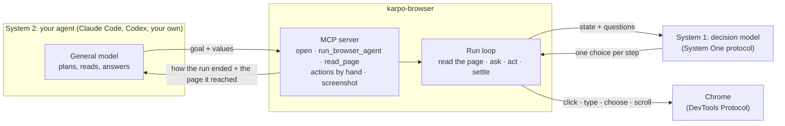

# karpo-browser

A browser for AI agents that splits the work in two: a fast decision model (**System 1**) does the steps on the
page, one choice per step; your agent's model (**System 2**) plans, reads and answers.

<p>
  <a href="https://www.npmjs.com/package/karpo-browser"></a>
  <a href="LICENSE"></a>
  
  
  <a href="#for-ai-agents"></a>
  <a href="#claude-code"></a>
</p>

Most browser agents ask a large model for every click. karpo-browser asks a large model only for what needs judgment
(the plan, the reading, the answer) and gives the clicking, typing, choosing and scrolling to a decision model that
picks one action per step from the page's own options.



## Why karpo-browser

- **Fast, cheap steps.** Each step is one choice among the page's numbered options, answered by a decision model
  instead of written out by a chat model.
- **Your agent stays in charge.** System 2 decides what to do and checks the result; System 1 only gets the page
  from one state to the next, and says how it ended when it cannot.
- **Any decision model.** System 1 is asked over the System One protocol: decision models hosted on OpenRouter, or a
  model on your own server.
- **Plugs into the agents you use.** A Claude Code plugin, Codex, or any MCP client; a skill tells the agent how to
  work the tools.
- **A library and a command line.** A typed TypeScript API and the `karpo-browser` command, with no runtime
  dependencies.
- **Secrets stay out of the model.** A password or a card number is typed into the page by name; no model sees it.

## Install

```bash
npm install -g karpo-browser
```

karpo-browser drives a local Chrome or Chromium (set `CHROME_PATH` when it is not in the usual place), or one that
runs already (`--cdp`, or `BROWSER_CDP_URL` for the MCP server). It needs Node.js 22.18 or later.

## Quick start

```bash
export SYSTEM1_MODEL=typesafe/jev-1.14   # a decision model on OpenRouter
export SYSTEM1_API_KEY=sk-or-...         # your OpenRouter key
karpo-browser run --url https://en.wikipedia.org/ --goal "Open the Wikipedia article about the Apache License" \
  --value "search=Apache License"
```

`run` gives one goal to System 1 and prints each step and where the run ended. System 1 types only the values it is
given (`--value name=text`): a value written only in the goal is not typed.

## How it works

- **System 1** is a decision model. At each step karpo-browser reads the page into numbered elements and asks the
  model which one step moves the goal forward, and whether the run is going in circles; the model answers by
  choosing, and karpo-browser carries the step out and waits for the page to settle.
- **System 2** is a general model in an agent: Claude Code, Codex, or your own. It gives System 1 goals through
  `run_browser_agent`, reads the page a run returns, acts by hand where a run is stuck, and answers.

A run ends with one of these statuses, and the page it reached:

| Status | What it means | What System 2 does next |
|---|---|---|
| `done` | System 1 judged the goal reached | Checks the page against the task |
| `needs_from_person` | The page needs a value or a choice the goal left open | Supplies it, then runs the rest of the goal |
| `needs_approval` | The next step pays, books or cannot be undone | Goes ahead only when the task says so |
| `site_cannot` | The site does not offer what the goal asks | Reports it, or tries another route |
| `blocked` | The site refused the browser | Tries another way once, else reports it |
| `page_unusable`, `other_failure` | The page could not be worked | Clears the point by hand, or retries with a clearer goal |
| `looping`, `limit` | The run went in circles, or reached its step or time limit | Finds where it got stuck, clears it, runs the rest |
| `interrupted` | The run was stopped from outside | — |
| `failed` | The run itself failed, e.g. System 1 could not be reached | Reads the detail |

## For AI agents

### Claude Code

```text
/plugin marketplace add machinepulse-ai/karpo-browser
/plugin install karpo-browser@karpo-browser
```

The plugin adds the MCP server and a skill that tells Claude how to use it. Set `SYSTEM1_MODEL` and `SYSTEM1_API_KEY`
(and `SYSTEM1_URL` for your own server) in the shell Claude Code starts from.

### Codex

```bash
codex mcp add karpo-browser \
  --env SYSTEM1_MODEL=typesafe/jev-1.14 --env SYSTEM1_API_KEY=sk-or-... \
  -- npx -y karpo-browser mcp
npx skills add machinepulse-ai/karpo-browser
```

Codex asks before each tool call that acts on a page; in `codex exec`, add `--approve-for-me` (or answer the prompts in
an interactive session).

### Other MCP clients

Start `npx -y karpo-browser mcp` as a stdio server with the `SYSTEM1_*` variables set. The server tells the client
how its tools are meant to be used when it starts; the full guide is
[skills/karpo-browser/SKILL.md](skills/karpo-browser/SKILL.md).

### MCP tools

| Tool | What it does |
|---|---|
| `open` | Opens an address and waits for the page to settle |
| `run_browser_agent` | Gives System 1 a goal and the values to type; answers how the run ended and the page it reached |
| `read_page` | The page as numbered elements with their states and text |
| `click`, `type`, `select`, `press_enter`, `escape`, `scroll`, `back` | One action by hand, on an element's number |
| `screenshot` | The viewport as a JPEG |

## Use it as a library

```ts
import { Browser } from "karpo-browser";

const browser = await Browser.launch({
  headless: true,
  decider: { url: "https://openrouter.ai/api/alpha/decisions", model: "typesafe/jev-1.14", apiKey: process.env.OPENROUTER_API_KEY },
});
try {
  await browser.open("https://en.wikipedia.org/");
  const result = await browser.run({
    goal: "Open the Wikipedia article about the Apache License",
    values: { search: "Apache License" },
  });
  console.log(result.status, result.url); // done https://en.wikipedia.org/wiki/Apache_License
  const page = await browser.read(); // the page as numbered elements, for System 2 to read
} finally {
  await browser.close();
}
```

- `Browser.connect(wsUrl)` works a browser that runs already, local or hosted, by its DevTools WebSocket address.
- `browser.act({ kind: "click", element: 5 })` and the other actions by hand, `browser.screenshot()`, and
  `browser.read()` are what the MCP tools call.
- `run({ goal, values, secrets })`: `secrets` are typed by name and never sent to System 1.
- Left out, `decider` comes from the `SYSTEM1_*` variables. Pass any object with
  `ask(request, context)` to answer decision requests your own way; the request and answer types are exported.

## System 1 models

karpo-browser asks System 1 over the System One protocol: it posts `{"model", "state", "questions"}` to
`SYSTEM1_URL` and reads `{"answers": …}` back. Screenshots go to OpenRouter as an item of a top-level `state` array
and to your own server in `state.viewport_screenshot`; set `imagesAsStateItems` in the library to choose.

| Model (`SYSTEM1_MODEL`) | Where (`SYSTEM1_URL`) |
|---|---|
| `typesafe/jev-1.14` | OpenRouter (the default address) |
| `google/gemini-decision-1` | OpenRouter |
| `openai/gpt-6-luna-decisions` | OpenRouter |
| Any model you serve that speaks the System One protocol | Your own server, e.g. `http://localhost:8000/v1/systemone` |

Requests are packed to each model's limits (`src/decider/models.ts`); a model the table does not name gets the most
cautious ones.

<details>
<summary>A request and its answer</summary>

```json
{
  "model": "typesafe/jev-1.14",
  "state": {
    "task": { "goal": "Open the Wikipedia article about the Apache License" },
    "values": [{ "n": 1, "name": "search", "text": "Apache License" }],
    "page": {
      "url": "https://en.wikipedia.org/",
      "title": "Wikipedia, the free encyclopedia",
      "elements": ["viewport (scrolled 0/2100px):", "  5 button Search", "…"]
    }
  },
  "questions": {
    "step": { "type": "choice", "instructions": "…", "criteria": { "CLICK 5": "button Search", "…": "…", "DONE": "…" } },
    "looping": { "type": "noul", "instructions": "…" }
  }
}
```

```json
{ "answers": { "step": { "choice": "CLICK 5", "probabilities": { "CLICK 5": 0.93, "DONE": 0.01 } }, "looping": { "noul": 0.02 } } }
```

</details>

## Configuration

| Variable | Meaning | Default |
|---|---|---|
| `SYSTEM1_URL` | System 1's endpoint, its whole address | `https://openrouter.ai/api/alpha/decisions` |
| `SYSTEM1_MODEL` | System 1's model | none: required |
| `SYSTEM1_API_KEY` | Sent as `Authorization: Bearer <key>` | none |
| `BROWSER_CDP_URL` | MCP server: work a browser that runs already (its DevTools WebSocket address) | start Chrome |
| `BROWSER_HEADLESS` | MCP server: `1` starts Chrome without a window | with a window |
| `CHROME_PATH` | The Chrome to start | the usual places |

`karpo-browser run` takes:

| Flag | Meaning |
|---|---|
| `--url <address>` | The page to start on |
| `--goal <goal>` | The end state to reach, and the limits to keep |
| `--value <name=text>` | A value System 1 may type (repeatable) |
| `--secret <name=VAR>` | A value typed without any model seeing it, read from the environment variable `VAR` (repeatable) |
| `--cdp <ws address>` | Work a browser that runs already instead of starting Chrome |
| `--headless` | Start Chrome without a window |
| `--json` | Print the result as JSON alone |

## Security

- **Secrets** given with `--secret` (or `secrets` in `run()`) are typed into the page by name and never sent to any
  model; their boxes are masked in what System 1 reads afterwards.
- **Keys** go only where they belong: `SYSTEM1_API_KEY` is sent to `SYSTEM1_URL`, never to an address set in code,
  and errors quote an endpoint without its user name, password or query.
- **Addresses**: the MCP server opens web pages (`http`, `https`) only, never a file of the machine it runs on.
- **Page text** is data: the skill and the MCP server's instructions tell System 2 never to follow instructions
  found on a page.

## The controller: an optional System 2

`test/controller` holds a System 2 of our own: a tool-calling loop over any OpenAI-compatible chat model, with the
same tools as the MCP server and a few more for evaluations. It uses only the library's public interface. It needs a
clone of this repository (the npm package ships only `dist/`), and the `SYSTEM1_*` variables as well as its own.

```bash
export SYSTEM2_MODEL=deepseek-v4.1-flash   # a preset, or any model id
export SYSTEM2_API_KEY=sk-or-...           # SYSTEM2_BASE_URL is OpenRouter's unless set
node test/controller/cli.ts --url https://books.toscrape.com/ "Find the price of the book A Light in the Attic"
```

`--benchmark` runs the configuration of our published runs: DeepSeek V4.1 Flash on OpenRouter, the provider left to
OpenRouter's routing, a 450 s deadline, and the options in `test/controller/benchmark.ts` (set `SYSTEM2_MODEL` to use
another model with those options). [`evals/stagehand`](evals/stagehand/README.md) runs it on Browserbase Benchmark v2
with Stagehand's eval harness.

## Development

```bash
npm install
npm run check   # types and lint
npm test        # unit tests; the live tests start Chrome when the machine has one
npm run build
```

The conformance tests (`npm run conformance`) replay recorded pages that are not part of this repository:
`CONFORMANCE_FIXTURES` names their directory.

## Contributing

Issues and pull requests are welcome. [AGENTS.md](AGENTS.md) lists the conventions (for people and for coding
agents alike), and [CHANGELOG.md](CHANGELOG.md) what changed in each release.

## License

Copyright (c) 2026 MachinePulse Pte. Ltd.

The code in this repository is licensed under the Apache License, Version 2.0 ([LICENSE](LICENSE)), except
[`evals/stagehand/stagehand.patch`](evals/stagehand/stagehand.patch), which is under Stagehand's MIT license
([LICENSE-stagehand](evals/stagehand/LICENSE-stagehand)).
